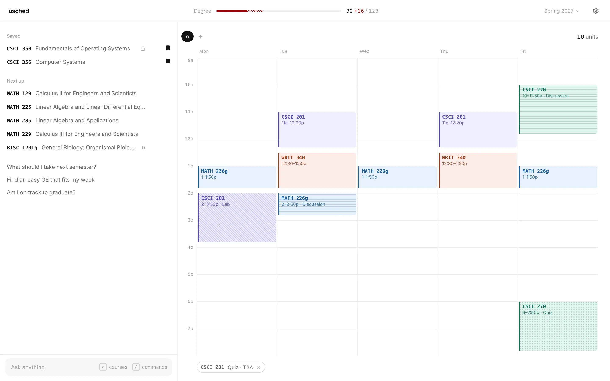
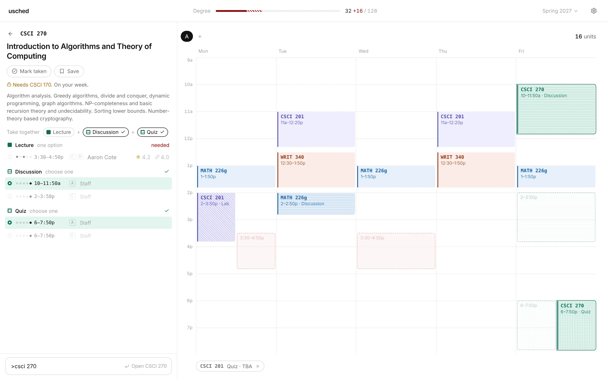
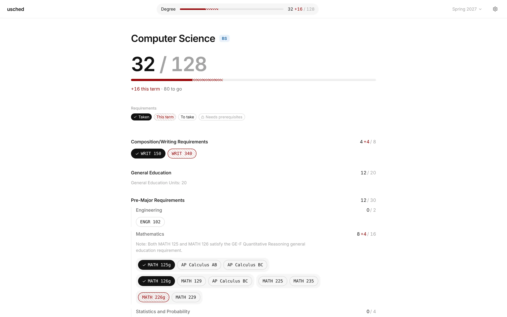
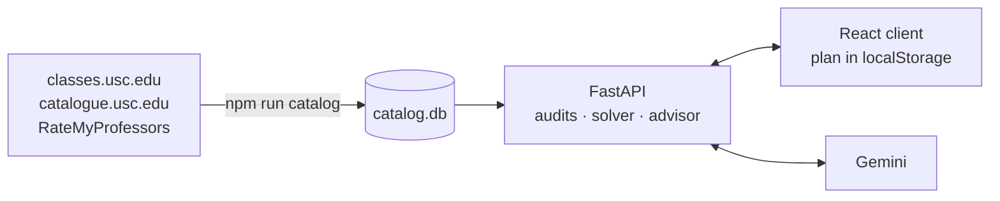

<div align="center">


# usched

**A calm course planner for USC students.**

Find classes, pick sections right on your week, and see how each choice moves
you toward your degree.

[](https://github.com/arvinduh/usched/actions/workflows/check.yml)


[Features](#features) · [Quick start](#quick-start) ·
[How it works](#how-it-works) · [Docs](docs/README.md) ·
[Deploy](docs/deploy.md)

</div>

<picture>
  <source
    media="(prefers-color-scheme: dark)"
    srcset="docs/assets/planner-dark.webp"
  />
  
</picture>

## Features

- **One input for everything.** Type to ask the advisor, start with `>` to find
  courses, or `/` to run a command such as `/took CSCI 103L, MATH 125`. It
  always says what Enter will do.
- **Sections on your week.** Open a course and its sections ghost onto the week;
  click one to take it. Linked lectures, labs, and quizzes stay together, and
  conflicts, units, missing components, and D-clearance show up as you go.
- **Your degree at a glance.** Every requirement of your program as chips:
  taken, on this term's week, available, or locked by prerequisites. GE
  categories, GE Seminars, and AP credit count the way USC counts them.
- **An advisor that checks its work.** The optional advisor answers from your
  real progress and builds schedules around your week. Each proposal wins a
  different trade-off (best professors, Friday off, a later start) and stays
  within the 18-unit flat-tuition maximum. Courses it names that the catalog
  lacks are flagged.
- **Private by default.** Your plan lives in your browser. The server only reads
  a public catalog and stores nothing about you.

<table>
  <tr>
    <td width="50%">
      <picture>
        <source
          media="(prefers-color-scheme: dark)"
          srcset="docs/assets/card-dark.webp"
        />
        
      </picture>
      <p align="center">
        <sub>Open a course; its sections ghost onto your week.</sub>
      </p>
    </td>
    <td width="50%">
      <picture>
        <source
          media="(prefers-color-scheme: dark)"
          srcset="docs/assets/degree-dark.webp"
        />
        
      </picture>
      <p align="center">
        <sub>Your degree, with this term's plan striped in.</sub>
      </p>
    </td>
  </tr>
</table>

## Quick start

You need [Node.js](https://nodejs.org) 22+ and [uv](https://docs.astral.sh/uv/),
which manages Python.

```bash
git clone https://github.com/arvinduh/usched.git && cd usched
npm install                        # Node packages, then Python via uv sync
cp .env.example .env               # optional: add a Gemini key for the advisor
uv run playwright install chromium # once, for the catalog fetcher
npm run catalog                    # fetch public USC data and build catalog.db
npm run dev
```

Open <http://localhost:18801>. The first visit asks for your program. Without a
Gemini key, everything but the advisor works; get a free key at
[Google AI Studio](https://aistudio.google.com).

See [Development](docs/development.md) for every command, the test layout, and
conventions.

## How it works



- **A built catalog.** `npm run catalog` fetches public course, section, rating,
  and degree data into a raw cache, then builds and verifies a fresh SQLite
  database. Nothing is scraped at request time.
- **Pure engines.** The degree audit, GE audit, and schedule solver are pure
  functions over the catalog, shared by the API and the advisor's tools.
- **A grounded advisor.** Each message carries a brief of the student's real
  progress and week. Its tools search the catalog and solve schedules, and its
  edits arrive as proposals you keep or discard.

## Documentation

- [Development](docs/development.md): setup, commands, tests, and conventions.
- [Deploy](docs/deploy.md): publish the catalog and run usched on Render.
- [Architecture](docs/architecture.md): how the pieces fit together.
- [Catalog pipeline](docs/catalog.md), [HTTP API](docs/api.md),
  [Degree and GE audits](docs/audits.md), [Schedule engine](docs/scheduling.md),
  [Advisor](docs/advisor.md), and [Client](docs/client.md): reference for each
  part.

## Contributing

Run `npm run check` before you push. It lints, type-checks, and tests both the
server and the client, and CI runs the same command on every pull request.
Commits follow Conventional Commits with a scope, such as `feat(advisor): …`.

usched is a student project and is not affiliated with the University of
Southern California. Course data comes from USC's public class schedule and
catalogue, and ratings from RateMyProfessors.
