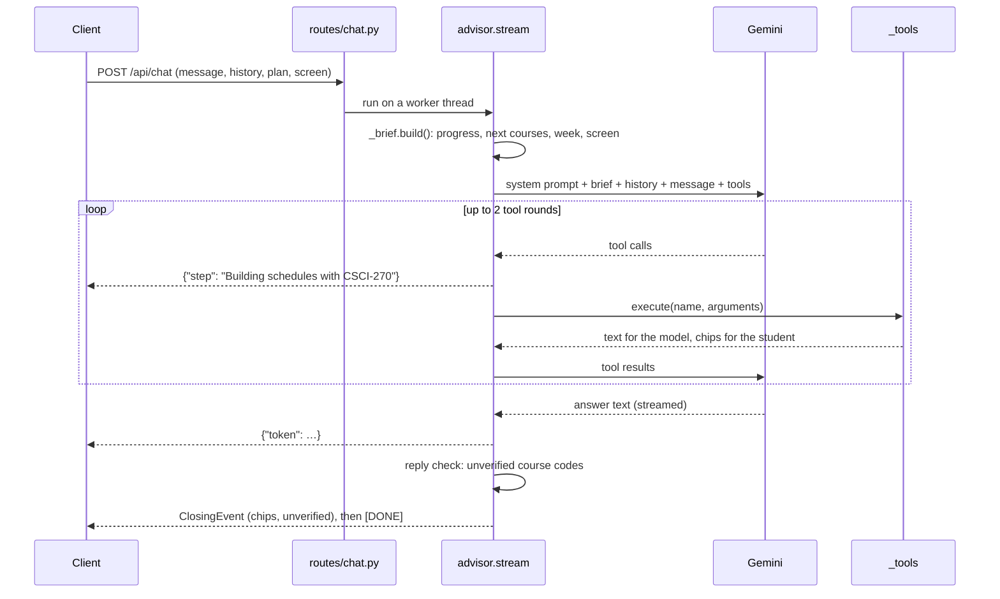

# Advisor

The advisor is an optional chat assistant on Google Gemini. It answers from the
student's real progress and edits their week through tools, so its schedules are
conflict-free and its courses exist. Everything else in usched works without it.
The code lives in `server/agent/`.

## Design goals

- **Grounded, not plausible.** A model asked "what can I take?" invents courses
  unless the answer is already in front of it. Every message therefore carries a
  brief computed from the catalog, and every course the reply names is checked
  afterward.
- **Proposals, not edits.** Tools never change the plan. Schedule changes come
  back as proposals the student keeps or discards on the week.
- **Private by construction.** The server stores nothing. Each request carries
  the plan, and prompts contain course codes and plans, never names.

## How a message flows



The chat route runs the blocking advisor (synchronous model and SQLite calls) on
a daemon thread and relays its output to the event loop. If the browser
disconnects, the route signals the thread to stop.

## The student brief

`_brief.py` builds the brief in milliseconds for each message. It contains:

- Degree progress from the program and GE audits.
- Courses the student can take next: offered this term, prerequisites met.
- Open GE categories.
- The active week, with conflicts and missing sections, and its units against
  the 18-unit flat-tuition maximum.
- The student's other schedules.
- What is on screen: the page, an open course, or a proposal on the week. This
  gives "this course" and "option 2" a referent.

Every course the brief names counts as grounded for the reply check.

## Tools

Tools cover what the brief cannot carry and what the student asks the advisor to
do. Each returns terse text for the model plus chips for the student.

| Tool                 | Does                                                                                                                                                   |
| :------------------- | :----------------------------------------------------------------------------------------------------------------------------------------------------- |
| `search_courses`     | Searches this term's courses by code, title, topic, or GE category.                                                                                    |
| `get_course_details` | One course's prerequisites, restrictions, description, and sections.                                                                                   |
| `solve_schedule`     | Finds up to three weeks that add the listed courses around the current week, each winning a different trade-off. See [Schedule engine](scheduling.md). |
| `edit_week`          | Previews the week with sections added, removed, or courses dropped.                                                                                    |
| `mark_taken`         | Records courses the student says they took.                                                                                                            |

Bad tool names or arguments become text for the model rather than errors, so the
model can correct itself. After two tool rounds, one more turn forbids tools, so
a reply always ends in words.

## Action chips

A reply ends with one-tap follow-ups, all derived from what the model actually
did. Proposed schedules and recorded courses always survive; other buttons are
capped at four. They form a discriminated union on `action` in `_chips.py`, so
the generated client types narrow on it and a malformed chip fails validation on
the server.

| Chip               | The client                                            |
| :----------------- | :---------------------------------------------------- |
| `propose_schedule` | Shows the sections on the week as a proposal to keep. |
| `enroll_section`   | Adds one section to the active schedule.              |
| `watch_course`     | Saves a course without picking sections.              |
| `mark_taken`       | Records courses as taken, with undo.                  |
| `search`           | Runs a course search in the column.                   |

`client/src/semester/assistant/_applyActionChip.ts` applies them.

## The reply check

After the reply finishes, `advisor.unverified()` collects every course code the
text names that no source backs: not in the brief, not in a tool result, and not
in the catalog. The closing event lists them, and the client renders them
unlinked with a note, so a made-up course is visible rather than clickable.

## Models and limits

`_llm.py` defines a `Model` protocol and the shared tool loop, so a provider
only translates one turn and tests fake a whole model. `Gemini` is the default
provider, reached over REST with streaming.

Configure it in `.env`:

| Variable         | Meaning                                                                                                         |
| :--------------- | :-------------------------------------------------------------------------------------------------------------- |
| `GEMINI_API_KEY` | A key from [Google AI Studio](https://aistudio.google.com). Without it, the advisor explains that it needs one. |
| `GEMINI_MODELS`  | An ordered list. Later models take over while earlier ones are busy or out of quota.                            |

Each Flash-Lite model allows 15 requests a minute on the free tier, and a
message takes one to three. Listing two models doubles that, since each has its
own quota. Past it, the advisor says it is busy for a minute.

## Evaluating changes

`npm run check` tests the advisor against a fake model. To check behavior on the
real one, run the live evals:

```bash
npm run test:live
```

This asks the model in your `.env` a set of student questions, such as fitting a
course, keeping Fridays free, dropping a course, or "option 2 but…". It checks
what each reply did: its schedules exist, have no conflicts, and keep what they
should, and it names no unknown course. It spends real quota.
