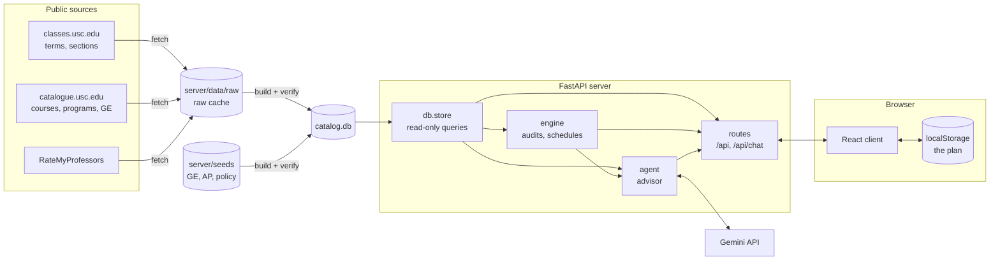

# Architecture

usched is two programs that share one origin in production: a FastAPI server
that reads a prebuilt SQLite catalog, and a React client that keeps the
student's plan in the browser. This page shows how the pieces fit and where
each responsibility lives.

## System overview

The design rests on three decisions:

- **The catalog is a build artifact.** The server never scrapes at request
  time. `npm run catalog` fetches public data into a raw cache, then builds and
  verifies a fresh `catalog.db`. The running server opens it read-only.
- **The plan never leaves the browser.** Schedules, saved courses, completed
  courses, and AP scores live in `localStorage`. Each request that needs them,
  such as an audit or an advisor message, carries them in its body. The server
  stores nothing about a student.
- **Engines are pure.** Audits and the schedule solver take API models and
  return API models. `engine/audits.py` is the one place that loads their
  inputs from the catalog, so the HTTP routes and the advisor's tools audit a
  student identically.

## Server layout

| Path                   | Responsibility                                                         |
| :--------------------- | :--------------------------------------------------------------------- |
| `server/main.py`       | App entry point. Opens the catalog and model, serves the built client. |
| `server/config.py`     | Environment variables, paths, and policy constants in one place.       |
| `server/db/schema.sql` | The catalog schema. No migrations: change it and rebuild.              |
| `server/db/models.py`  | Pydantic API models and the dataclass rows that mirror the schema.     |
| `server/db/store.py`   | The only runtime reader of `catalog.db`; batched, term-scoped queries. |
| `server/db/search.py`  | Turns search text into an FTS5 match, with abbreviation expansion.     |
| `server/db/ingest/`    | Fetchers, pure parsers, build, verify, and publish.                    |
| `server/engine/`       | Degree audit, GE audit, and the schedule solver.                       |
| `server/agent/`        | The advisor: student brief, tools, chips, model, tool loop.            |
| `server/routes/`       | HTTP routes for the catalog, audits, and chat.                         |
| `server/seeds/`        | Checked-in policy that USC states only in prose.                       |

Modules prefixed with `_` are private to their package. For example,
`engine/_ge_audit.py` is reached only through `engine/audits.py`.

## Client layout

| Path                   | Responsibility                                                         |
| :--------------------- | :--------------------------------------------------------------------- |
| `client/src/App.tsx`   | Picks the term, composes the planner and degree, owns the open course. |
| `client/src/api/`      | Typed calls, one per route. Types are generated from OpenAPI.          |
| `client/src/state/`    | The persisted plan store, transient previews, undo, theme.             |
| `client/src/semester/` | The column, the input, course lines and cards, the week.               |
| `client/src/degree/`   | Program picker, requirement chips, GE strip.                           |
| `client/src/shell/`    | Top bar, first-run welcome, loading splash.                            |
| `client/src/ui/`       | Shared glyphs, select, toast, context menu, overlays.                  |

See [Client](client.md) for how state flows through these.

## Request lifecycle

A typical interaction touches each layer once:

1. The client loads terms, then searches a term's courses with
   `GET /api/terms/{term}/courses?q=…`.
2. `store.search_courses` runs one FTS5 query for the page of matches, then
   one query per child table (sections, meetings, instructors, ratings) for the
   whole page, and assembles `Course` models.
3. The student picks a section on the week. The client writes its id to the
   plan store, and checks conflicts and missing components locally with
   `semester/_schedule.ts`, which mirrors the server's rules.
4. The degree page posts the plan to
   `POST /api/terms/{term}/programs/{id}/audit`, and `engine/audits.py`
   composes the program and GE audits.

The advisor follows the same path, with a model in the middle. See
[Advisor](advisor.md).

## Production shape

The `Dockerfile` builds the client, then copies `client/dist` next to the
server so one Uvicorn process serves the page and the API from one origin.
Hashed assets are cached for a year; `index.html` is always revalidated. The
catalog is downloaded into the image at build time from a GitHub release. See
[Deploy](deploy.md).
