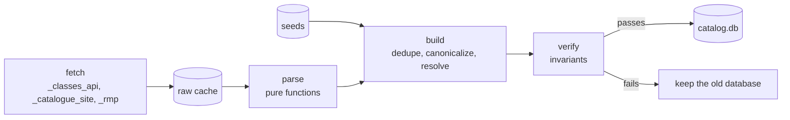

# Catalog pipeline

The catalog is a SQLite database of USC courses, sections, instructors,
ratings, degree programs, and GE policy. It is generated from public sources
and never committed. This page explains how `npm run catalog` builds it and
how to change it.

## Before you begin

- Install the browser the fetcher uses to pass the catalogue site's bot
  firewall (no USC login is involved):

  ```bash
  uv run playwright install chromium
  ```

- To publish a catalog for deployment, sign in to the
  [GitHub CLI](https://cli.github.com) with `gh auth login`.

## Commands

```bash
npm run catalog                     # fetch what is stale, then build
npm run catalog -- fetch            # refresh the raw cache only
npm run catalog -- build            # rebuild offline from the cache
npm run catalog -- publish          # upload the database for deployment
npm run catalog -- fetch build publish
uv run catalog --helpfull           # every flag, e.g. --terms=20271
```

A failed fetch keeps the cache's previous copy, so the build still runs, but
the command exits 1. A build that fails verification leaves the live database
untouched and also exits 1. A scheduled refresh therefore never reports
success while serving stale data.

## Stages



### Fetch

Each source has its own fetcher in `server/db/ingest/` and its own freshness
window, so routine runs refetch only section listings.

| Source              | Module               | What it fetches                                             | Refetched after |
| :------------------ | :------------------- | :---------------------------------------------------------- | :-------------- |
| classes.usc.edu API | `_classes_api.py`    | Active terms, schools, listings per (term, school, program) | 12 hours        |
| catalogue.usc.edu   | `_catalogue_site.py` | Program pages, the expanded course index, GE lists          | 7 days          |
| RateMyProfessors    | `_rmp.py`            | One search per instructor, including empty results          | 30 days         |

`_http.py` owns transport: a pooled client with browser-like headers, and
retries with backoff for network errors, 429s, and 5xx responses. Fetches run
in parallel.

### Raw cache

`_cache.RawCache` stores exactly what each source returned under
`server/data/raw/`, keyed by paths such as
`classes/20271/programs/ENGV-CSCI.json`. Writes are atomic. Keeping raw
payloads makes builds reproducible and offline: the same cache always gives
the same database.

### Parse

Parsers are pure functions over cached payloads, tested against fixtures in
`tests/catalog/fixtures/`:

- `_parse_classes.py` reads terms, schools, and listings into course,
  offering, section, meeting, instructor, requisite, and restriction rows.
- `_parse_courses.py` reads the catalogue's course index: canonical titles,
  units, descriptions, and GE categories stated on a course. GE Seminars
  (`GESM 1X0`, `1X1`) fill the Core category their number names and the
  seminar requirement.
- `_parse_catalogue.py` reads program pages as ordered text blocks. Headings
  become a requirement tree, course items become choice slots (items joined by
  "or" share a slot), and prose becomes notes.

### Build

`build.py` collects every parsed row, then:

1. Deduplicates rows by primary key. The same listing can arrive under two
   schools.
2. Gives each course one canonical spelling, the catalogue's where it defines
   the course.
3. Resolves course references (requisites, program choices, GE lists) against
   the catalog. References keep the source's spelling in `*_code` and point at
   the catalog row in `resolved_code`.
4. Writes a fresh database to a temporary file.

Course identity is defined in `codes.py`: department, number, and an optional
sequence letter. Attribute letters (L lab, g GE, x, m, w, p) are ignored, so
`MATH-118gx`, `MATH-118xg`, and `math 118` are the same course everywhere.

### Verify

`_verify.py` checks invariants that constraints alone cannot express, such as
meeting times inside a day, unit ranges in order, and every fetched term
populated. Any violation fails the build. Resolution rates, such as how many
requisites resolved, are reported but not enforced, because they depend on
how much of USC the cache holds.

### Publish

`_publish.py` verifies the database and uploads it to the repository's
`catalog` GitHub release, creating it on first use, then prints the
`CATALOG_URL` that deployments download. See [Deploy](deploy.md).

## Schema

`server/db/schema.sql` is the source of truth. It has no migrations: change it
and rebuild. The tables fall into groups:

| Group    | Tables                                                                                    |
| :------- | :---------------------------------------------------------------------------------------- |
| Terms    | `term`, `school`, `department`, `session`                                                 |
| Courses  | `course`, `offering`, `offering_usc_ge`, `catalogue`, `catalogue_course`                  |
| Sections | `section`, `meeting` (weekday bitmask), `instructor`, `section_instructor`, `rmp_profile` |
| Rules    | `requisite_group`, `requisite_course`, `restriction`                                      |
| Programs | `program`, `program_requirement`, `program_requirement_choice`                            |
| Policy   | `ge_category`, `ge_course`, `ap_exam`, `ap_exam_ge`, `ap_exam_waiver`                     |
| Search   | `offering_fts` (FTS5 over code, title, and description)                                   |

Course codes compare case-insensitively but keep USC's spelling.

## Seeds

Some policy exists only in USC's prose, so it is checked in as reviewable JSON
in `server/seeds/` and read at build time:

| File                 | Contents                                                          |
| :------------------- | :---------------------------------------------------------------- |
| `ge_categories.json` | Each GE category's area (core, global, seminar) and seat count.   |
| `ap_exams.json`      | AP exams, minimum scores, units, GE categories, waived courses.   |
| `degree_policy.json` | The 128-unit bachelor's minimum, used when a program states none. |
| `abbreviations.json` | Search abbreviations such as "cs". The client bundles it too.     |

> **Note:** `ap_exams.json` was entered by hand and is not yet checked against
> the catalogue's AP credit chart.

Changing a seed takes a rebuild (`npm run catalog -- build`) and, for the
hosted app, a publish.
