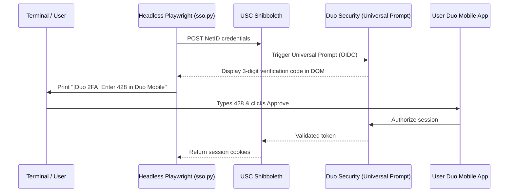

# usched: Master Implementation & Architecture Specification

## 1. System Overview & Core Objectives

**`usched`** is a high-performance academic scheduling optimizer and degree
advising application engineered for University of Southern California (USC)
students. It provides:

1. **Interactive Weekly Timetable:** Visual distinction between **enrolled**
   (solid border) and **wishlist** (dashed border) sections, with real-time
   interval collision detection and banner alerts.
2. **Visual Degree Audit & Prerequisite DAG:** Real-time graduation checklist
   with an interactive prerequisite graph (nodes colored green for completed,
   yellow for eligible, and red for locked).
3. **Faculty Intelligence (RateMyProfessors):** Live instructor ratings,
   difficulty scores, review counts, and "take again" percentages attached to
   every section and course card.
4. **On-Device Local AI Academic Advisor:** Powered by **Qwen 3.5 4B** (via
   Ollama) and **EmbeddingGemma 2**, providing grounded course recommendations,
   conflict analysis, and interactive action chips via Server-Sent Events (SSE).

---

## 2. Ingestion Pipeline & USC Data Sources

### A. USC Schedule of Classes (`classes.usc.edu`) Architecture

USC's Schedule of Classes is a modern Angular Single Page Application backed by
an OpenAPI/REST backend hosted directly at `https://classes.usc.edu/api/`.

> [!IMPORTANT] The historical 2018 WordPress HTML layout
> (`<div class="course-info-expand">`, `<tr class="section">`) is completely
> obsolete. `classes.usc.edu` exposes clean, fast JSON REST endpoints that do
> **not** require cookies or authentication for catalogue and schedule data.

#### Exact REST Endpoints

1. **Term Discovery (`GET /api/Terms/All`):**
   - Discovers all active and upcoming semester terms.
   - Sample response:

     ```json
     [
       {
         "seasonName": "Fall",
         "status": "Active",
         "termCode": 20263,
         "season": "Fall",
         "year": 2026
       },
       {
         "seasonName": "Spring",
         "status": "Active",
         "termCode": 20271,
         "season": "Spring",
         "year": 2027
       }
     ]
     ```

2. **School & Program Hierarchy (`GET /api/Schools/TermCode?termCode={term}`):**
   - Maps undergraduate schools to departmental program prefixes.
   - Example: School `ENGV` (Viterbi School of Engineering) contains program
     `CSCI` (Computer Science); School `LAS` (Dornsife College) contains
     programs `MATH`, `WRIT`, `PHYS`, `CHEM`.

3. **Department Course Discovery
   (`GET /api/Courses/CoursesByTermSchoolProgram`):**
   - Query: `?termCode={term}&school={school}&program={program}`
   - Returns all course catalogue stubs for that department (course ID,
     `fullCourseName`, `classNumber`, `suffix`, units, and descriptions).

4. **Section & Structured Prerequisite Enrichment (`GET /api/Courses/Course`):**
   - Query: `?termCode={term}&courseCode={dept}-{classNumber}` (e.g., `CSCI-104`
     or `MATH-226`).
   - Returns full course details with **two critical structured payloads**:
     - **Structured Prerequisites (`prerequisiteCourseCodes`):** Pre-parsed
       requirement groups directly from USC's SIS:

       ```json
       [
         {
           "order": 1,
           "requiredCourses": 1,
           "courseOptions": [
             { "courseHyphen": "CSCI-103", "prefix": "CSCI", "number": "103" }
           ]
         },
         {
           "order": 1,
           "requiredCourses": 1,
           "courseOptions": [
             { "courseHyphen": "CSCI-170", "prefix": "CSCI", "number": "170" }
           ]
         }
       ]
       ```

     - **Live Scheduled Sections (`sections`):**

       ```json
       [
         {
           "sisSectionId": "29903",
           "rnrMode": "Lecture",
           "schedule": [
             {
               "dayCode": "TH",
               "days": ["Tue", "Thu"],
               "startTime": "12:30",
               "endTime": "13:50"
             }
           ],
           "totalSeats": 210,
           "registeredSeats": 123,
           "waitlistedSeats": 0,
           "instructors": [{ "firstName": "Carter", "lastName": "Slocum" }]
         }
       ]
       ```

### B. Headless Duo 2FA Authentication Flow (`sso.py`)

While public course listings are available via the REST API without
authentication, student-specific personal records (such as completed course
history and personalized degree audit records from OASIS / MyUSC) require
Shibboleth SSO with Duo Verified Push (3-digit Number Matching).



- **Implementation:** Playwright runs in headless Chromium (`headless=True`),
  navigates to `https://classes.usc.edu/bff/login`, fills credentials, polls the
  Duo container for the 3-digit match code, and displays it prominently in the
  terminal. Once approved on the mobile phone, cookies are captured.

### C. RateMyProfessors GraphQL Client (`rmp.py`)

- **Endpoint:** `POST https://www.ratemyprofessors.com/graphql`
- **School ID:** `U2Nob29sLTEzODE=` (USC)
- **Authorization:** `Basic dGVzdDp0ZXN0`
- **Normalization:** Instructor names from USC sections are converted from
  `"Last, First"` to `"First Last"`.
- **Extracted Metrics:** Overall quality rating (`avgRating` out of 5.0),
  difficulty (`avgDifficulty`), total student reviews (`numRatings`), and
  recommendation rate (`wouldTakeAgainPercent`).
- **Caching:** Ratings are persisted in the `instructors` SQLite table to
  eliminate redundant external queries.

### D. University Catalogue Scraper (`catalogue.usc.edu`)

- **Source:** Acalog Catoid 22 (USC Catalogue).
- **Target:** Degree program preview pages (e.g., `poid=11993` for Computer
  Science BS).
- **Extracted Content:** Major Core courses, Mathematics & Science Foundation,
  Upper-Division Electives, General Education categories, and credit unit
  thresholds (e.g., 128 units total).

---

## 3. Storage Architecture: SQLite, FTS5 & Embeddings

The database resides at `server/data/usched.db`.

### Table Schemas

```sql
CREATE TABLE instructors (
  id TEXT PRIMARY KEY,
  name TEXT NOT NULL,
  department TEXT NOT NULL DEFAULT '',
  rmp_id TEXT,
  rmp_rating REAL,
  rmp_difficulty REAL,
  rmp_num_ratings INTEGER NOT NULL DEFAULT 0,
  rmp_take_again_percent REAL
);

CREATE TABLE courses (
  id TEXT PRIMARY KEY,            -- e.g. "CSCI-104L"
  department TEXT NOT NULL,        -- e.g. "CSCI"
  number TEXT NOT NULL,            -- e.g. "104L"
  title TEXT NOT NULL,             -- e.g. "Data Structures and Object-Oriented Design"
  description TEXT NOT NULL DEFAULT '',
  units REAL NOT NULL DEFAULT 4.0,
  prerequisites_raw TEXT NOT NULL DEFAULT '',
  prerequisites_json TEXT NOT NULL DEFAULT '[]', -- Nested JSON for OR/AND clauses
  corequisites_raw TEXT NOT NULL DEFAULT '',
  ge_category TEXT,
  embedding BLOB                  -- 768-dim float32 binary buffer
);

CREATE TABLE sections (
  id TEXT PRIMARY KEY,            -- e.g. "29903"
  course_id TEXT NOT NULL,
  section_type TEXT NOT NULL,      -- "Lecture", "Lab", "Discussion", "Quiz"
  term TEXT NOT NULL,              -- e.g. "20263"
  days TEXT NOT NULL,              -- e.g. "Tue,Thu"
  start_time TEXT NOT NULL,        -- "12:30"
  end_time TEXT NOT NULL,          -- "13:50"
  start_minute INTEGER NOT NULL,   -- 750 (minutes from midnight)
  end_minute INTEGER NOT NULL,     -- 830 (minutes from midnight)
  location TEXT NOT NULL DEFAULT '',
  instructor_id TEXT,
  enrolled INTEGER NOT NULL DEFAULT 0,
  capacity INTEGER NOT NULL DEFAULT 0,
  waitlist INTEGER NOT NULL DEFAULT 0,
  FOREIGN KEY (course_id) REFERENCES courses (id) ON DELETE CASCADE,
  FOREIGN KEY (instructor_id) REFERENCES instructors (id) ON DELETE SET NULL
);

CREATE TABLE degrees (
  id TEXT PRIMARY KEY,            -- e.g. "csci-bs"
  title TEXT NOT NULL,
  school TEXT NOT NULL,
  total_units REAL NOT NULL,
  rules_json TEXT NOT NULL         -- Array of DegreeCategory objects
);

-- Full-Text Keyword Index (FTS5)
CREATE VIRTUAL TABLE courses_fts USING fts5(
  id,
  department,
  number,
  title,
  description,
  content='courses',
  content_rowid='rowid'
);
```

### Ingestion Update Strategy & Stale Data Policy

- Courses and degree programs use `INSERT OR REPLACE` to update metadata and
  descriptions without breaking foreign-key relationships.
- When ingesting a target term (e.g., `20263`), sections are scoped by term:
  `DELETE FROM sections WHERE term = ?` before inserting fresh live sections.
  This removes cancelled or rescheduled sections while preserving historical
  records.
- A pre-seeded database snapshot is checked into git at `server/data/usched.db`
  so the application runs immediately without requiring ingest on first boot.

### Semantic Search & Vector Embeddings

- **Model:** **`EmbeddingGemma 2`** (`google/embeddinggemma-2`, 270M
  parameters).
- **Dimension:** 768-dimensional float32 vector representations.
- **Embedded Document:**
  `"{course_id} {title}: {description} Units: {units}. Prerequisites: {prerequisites_raw}"`.
- **Storage:** Serialized with `numpy.ndarray.tobytes()` as binary `BLOB` in
  `courses.embedding`.
- **Query Ranking:** Hybrid scoring combining FTS5 BM25 keyword matching with
  vector cosine similarity (`np.dot(query_norm, doc_norm)`).

---

## 4. Academic Analysis Engines

### A. Conflict Detection Engine (`engine/conflicts.py`)

- Converts meeting times to minutes from midnight (0–1439).
- For any two sections $A$ and $B$, checks whether they share any meeting days:
  $$\text{common\_days} = \text{days}_A \cap \text{days}_B$$
- On shared days, detects collision if:
  $$\max(\text{start}_A, \text{start}_B) < \min(\text{end}_A, \text{end}_B)$$
- Differentiates between hard conflicts (both sections marked enrolled) and
  informational warnings (one enrolled, one on wishlist).

### B. Prerequisite DAG Engine (`engine/prereqs.py`)

- Evaluates prerequisite trees against student completed course history.
- Handles nested logic:
  - Atomic clause: `"CSCI-103"` $\rightarrow$ requires completed course.
  - Nested OR list: `["MATH-125", "MATH-126"]` $\rightarrow$ satisfied if any
    item is completed.
- Assigns statuses:
  - `completed`: Already satisfied in student record.
  - `eligible`: All prerequisite clauses are satisfied.
  - `locked`: One or more prerequisites are missing.

### C. Degree Audit Engine (`engine/audit.py`)

- Computes completed unit sums per category (Major Core, Math/Science,
  Electives, GE).
- Calculates overall graduation percentage:
  $$\text{percent\_complete} = \min\left(100.0, \frac{\text{completed\_units}}{\text{total\_units}} \times 100\right)$$
- Outputs complete prerequisite DAG nodes with status metadata.

---

## 5. Local AI Academic Advisor (`agent/advisor.py`)

- **Model:** **`Qwen 3.5 4B`** via Ollama (`qwen3.5:4b`).
- **Context Injection:** Injects student's enrolled courses, wishlist, completed
  courses, and target degree into the system prompt.
- **Function Calling Tools:**
  - `search_courses(query, department, ge_category)`
  - `check_schedule_conflicts(section_ids)`
  - `audit_degree_progress(completed_courses, degree_id)`
  - `get_instructor_reviews(instructor_name)`
- **Response Format:** Streams markdown tokens via SSE (`text/event-stream`)
  with structured action chips attached to recommendations:
  `{"label": "Add CSCI 201 to Calendar", "action": "add_section", "payload": "30120"}`.

---

## 6. Symmetrical Project Layout & Ports

| Component        | Port    | Description                                |
| :--------------- | :------ | :----------------------------------------- |
| **Backend API**  | `18800` | FastAPI REST & SSE endpoints with SQLite   |
| **Frontend Web** | `18801` | Vite + React + TypeScript with CSS Modules |

```
usched/
├── pyproject.toml              # Root uv manifest (Python 3.14, ruff, basedpyright)
├── package.json                # Root npm scripts (dev, ingest, build)
├── docs/plan.md                # Comprehensive architecture plan
│
├── server/
│   ├── data/usched.db          # SQLite database with FTS5 and embeddings
│   └── src/
│       ├── main.py             # FastAPI entrypoint (port 18800)
│       ├── database.py         # SQLite connection, FTS5 triggers, vectors
│       ├── models.py           # Pydantic data schemas
│       ├── ingest.py           # Pipeline runner ('npm run ingest')
│       ├── seed.py             # Canonical seed generator
│       ├── scraper/
│       │   ├── classes.py      # classes.usc.edu REST API client
│       │   ├── catalogue.py    # catalogue.usc.edu Acalog scraper
│       │   ├── rmp.py          # RateMyProfessors GraphQL client
│       │   └── sso.py          # Headless Duo 2FA with terminal code display
│       ├── engine/
│       │   ├── conflicts.py    # Interval collision math
│       │   ├── prereqs.py      # Prerequisite DAG validator
│       │   └── audit.py        # Degree progress calculator
│       └── agent/
│           ├── ollama.py       # Ollama HTTP client
│           ├── tools.py        # Advisor tool functions
│           └── advisor.py      # Multi-turn SSE advisor orchestrator
│
└── client/
    ├── vite.config.ts          # Port 18801 with /api proxy to 18800
    ├── package.json            # React, TypeScript, Lucide
    └── src/
        ├── App.tsx             # Two-pane layout (Advisor left, Tabs right)
        ├── components/
        │   ├── Calendar/       # Mon-Fri 8am-8pm weekly grid
        │   ├── DegreeAudit/    # Audit checklist & visual DAG
        │   ├── CourseExplorer/ # FTS5/vector search & RMP filters
        │   └── Chat/           # Streaming AI advisor interface
        └── types/index.ts      # TypeScript models
```

---

## 7. Python Engineering Standards (`python-guide`)

All Python files strictly adhere to:

1. **2-space indentation** (not 4).
2. **No `from __future__ import annotations`** (quote forward references).
3. **Import modules, not symbols** (`from server.src import models`, then
   `models.Course()`).
4. **80-column line limit** enforced by Ruff.
5. **Quality Gate:**
   `uv run ruff check . && uv run ruff format --check . && uv run basedpyright`.
